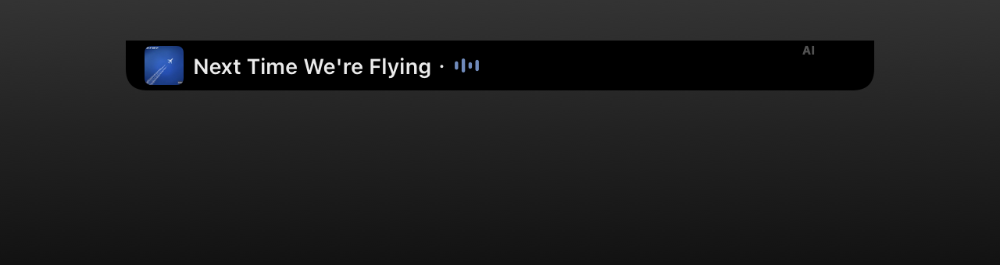
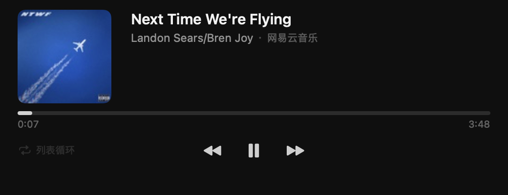
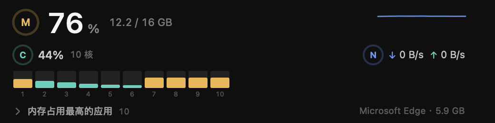

<div align="center">


# WoodDeck

macOS 屏幕顶部的灵动岛：AI 编程工具的额度与用量、正在播放的音乐、编程助手的会话提醒，都收在刘海两侧那一小条里。

原生实现，Swift 6 与 SwiftUI 编写，用 AppKit 开一块无边框面板。界面跟随系统语言，中文与英文都可用。

[](https://www.apple.com/macos/)
[](https://www.swift.org/)
[](LICENSE)
[](https://github.com/Awoodwhale/WoodDeck/releases)

</div>



## 功能

### 收起形态

三种样式，尺寸与位置都可以调整。显示哪些内容由「显示额度」「显示音乐」「显示会话」「显示时间」四个开关统一决定，三种样式共用这些选择：

| 样式 | 默认尺寸 | 说明 |
| --- | --- | --- |
| 刘海 | 431 × 32（镜头区域 185 + 音乐侧 150 + AI 侧 96） | 贴在屏幕顶部中央，横跨刘海 |
| 胶囊 | 196 × 32，距屏幕顶部 5 pt | 悬在刘海下方 |
| 指示条 | 56 × 4，距屏幕顶部 4 pt | 只画一条进度，不显示文字与时间 |

- 带摄像头的 MacBook 上有两种排版：
  - **分列刘海两侧**（默认）：收起形态与刘海同高、横跨刘海，左侧放音乐（封面、歌名或歌词、律动条，左上角有「音乐」角标），右侧放额度与会话提醒（右上角有「AI」角标），中间正好让开摄像头区域。音乐侧宽度 100–320 pt，AI 侧宽度 56–200 pt。
  - **整体在刘海下方**：形状从屏幕顶部向下延伸，内容画在摄像头区域下方。
  - 两种排版下，展开面板都挂在刘海下方。
- 没有刘海的屏幕上，收起形态按内容自适应宽度：歌词、配额环与时间都放得下。
- 展开方式可选「鼠标停留」或「点击」。停留模式要先停够设定的毫秒数（默认 250 ms）才展开，移开后立即收起；点击模式只在点击时展开，再点一次或按 Esc 收起。
- 配额环按各工具当前最高的配额使用率填色，达到预警（70%）与告警（90%）时换成对应颜色；使用率升高到这两档时，收起形态显示 5 秒提醒，可以关闭。
- 有助手在等你处理时，收起形态显示对应助手的图标与待处理数量。
- 时间支持简约、上下、数码管、点阵、分段、霓虹、衬线、宽体、窄体九种样式，颜色可选白色、琥珀、青色、粉色、青柠、渐变、跟随封面与自定义。
- 全屏应用在最前面时，可以设为隐藏或只显示指示条。
- 面板显示在哪块屏幕可选：系统主显示屏（默认）、鼠标所在的显示屏，或指定的某一块屏幕。屏幕断开后回到系统主显示屏。

### 展开面板

四页：**额度**、**会话**、**音乐**、**监控**，每页整页可上下滚动。



- **额度**：按工具分列显示套餐、各窗口的配额使用率与重置倒计时，并汇总今日与最近七日的 Token 用量与费用估算；配额条目不受面板高度限制，超出时上下滚动。点开汇总可按模型查看明细。
- **会话**：列出正在运行的编程助手会话，点击任意会话在同一页展开完整对话。
- **音乐**：封面、标题、歌手与来源、最多三行歌词、进度条与两端时间，以及播放控制。
- **监控**：CPU 总占用与逐核心占用、内存占用与总量、网络上下行速率，以及按内存占用排序的应用列表。



macOS 没有公开的 GPU 占用接口，监控页的这一项显示为不可用并注明原因，不填数字。

### 音乐

读取系统「正在播放」的曲目、封面与进度，支持播放、暂停、上一首、下一首、拖动进度、随机与循环。歌词自动获取，随播放位置换句，换句时交叉淡入淡出：字幕比声音早一点时，可用「歌词延迟」整体推后（默认 300 ms，范围 0–1000 ms）。

macOS 15.4 起，第三方应用读取系统媒体信息需要 mediaremote 适配器。WoodDeck 随应用打包 [mediaremote-adapter](https://github.com/ungive/mediaremote-adapter)，通过系统自带的 `/usr/bin/perl` 加载 `MediaRemoteAdapter.framework` 读取「正在播放」并发送控制命令。凡是接入系统媒体控制的播放器都能显示与控制，包括 Apple Music、Spotify、QQ 音乐、网易云音乐与浏览器里的网页播放器。

播放模式与「喜欢」按钮只在播放器报告自己支持时才出现。网易云音乐在 macOS 上不向系统报告这两项能力，因此它的面板里不显示这两个按钮。

### 支持的工具

最多同时显示 7 个工具，每个工具的配额来源与用量统计来源分别可配：

| 工具 | 配额 | Token 用量与费用 | 读取位置 |
| --- | :---: | :---: | --- |
| Claude | ✓ | ✓ | `~/.claude`（或钥匙串中的 Claude Code 登录）、`~/Library/Application Support/Claude` |
| Codex | ✓ | ✓ | `~/.codex` |
| Cursor | ✓ | ✓ | `~/Library/Application Support/Cursor/User/globalStorage/state.vscdb` |
| Antigravity | ✓ | ✓ | Antigravity 桌面版本机服务、`~/.gemini` |
| Grok Bot | ✓ | | `~/Library/Application Support/Grok Bot` |
| ZCode | ✓ | ✓ | `~/.zcode` |
| DeepSeek Harness | ✓ | ✓ | `~/.dsh` |
| 智谱 GLM、Z.ai GLM、DeepSeek、New API、Sub2API | ✓ | | 在设置里填写站点与密钥 |
| 自定义 | ✓ | | 写一段 JavaScript |

在设置里填 `CLAUDE_CONFIG_DIR`、`CODEX_HOME`、`ZCODE_HOME`、`DSH_HOME` 可以把读取目录换到别处，这些变量须为绝对路径。

### 会话通知

每个助手单独开关，开关与安装入口都在「设置 › 会话通知」：

| 助手 | 接入方式 | 说明 |
| --- | --- | --- |
| Claude Code | `~/.claude/settings.json` 的 hooks | 注册 `SessionStart`、`UserPromptSubmit`、`PreToolUse`、`PostToolUse`、`PermissionRequest`、`Notification`、`Stop` 等事件，命令为 `WoodDeck --hook claude` |
| Codex | `~/.codex/config.toml` 的 `notify` | 命令为 `WoodDeck --hook codex`，接收 `agent-turn-complete` 事件 |
| Gemini CLI | `~/.gemini/settings.json` 的 hooks | 注册 `SessionStart`、`BeforeAgent`、`AfterAgent`、`BeforeTool`、`AfterTool`、`Notification` |
| opencode | `~/.config/opencode/plugin/wooddeck.ts` 插件 | 插件把会话、消息、工具与权限事件转给 `WoodDeck --hook opencode` |
| DeepSeek Harness | 本地 Cordis 插件 `dsh-wooddeck-hook` | 在设置里一键启用：自动检测本机的 `dsh`，找不到时可以手动填写安装路径；启用后写入插件并挂到 profile 的 `cordis.patch.yml`，订阅 `session/created`、`user/message`、`tool/call`、`tool/result`、`approval/asked`、`turn/end`、`session/disposed`，把事件交给 `WoodDeck --hook dsh` |

事件通过本机 Unix 套接字（`~/Library/Application Support/WoodDeck/hooks/sessions.sock`，权限 600）传给应用，不占用端口，也不经过网络。写入失败会被忽略，助手的命令不会因为 WoodDeck 没运行而报错。

安装只追加属于自己的条目，卸载只删除属于自己的条目，不改动你在这些配置里已有的其它内容。DeepSeek Harness 的插件安装会把 `cordis.patch.yml` 备份为 `cordis.patch.yml.bak-wooddeck`，写入前校验 YAML。

### 外观

设置 › 外观 › 面板配色提供 6 套内置深色主题：深色、One Dark Pro、GitHub 深色、Dracula、夜鸮、赛博朋克。收起形态的底色与描边、展开面板的底色、强调色与警示色都随主题变化。

## 安装

从[发布页](https://github.com/Awoodwhale/WoodDeck/releases)下载 `WoodDeck-0.0.1.dmg`，双击挂载，把 `WoodDeck.app` 拖进「应用程序」文件夹，然后打开。

应用使用本地签名，没有经过 Apple 公证。首次运行前在终端执行一次：

```sh
xattr -dr com.apple.quarantine /Applications/WoodDeck.app
```

macOS 会给浏览器下载的文件加上 `com.apple.quarantine` 隔离标记。带标记的应用在启动时由 Gatekeeper 检查开发者签名与公证记录，没有这两项时系统会提示应用无法验证开发者或已损坏。去掉标记后，系统不再对这份副本做这项检查，应用即可正常启动；每次重新下载的副本都要执行一次。

## 从源码构建

需要 macOS 26 或更高版本、Xcode 26 或更高版本：

```sh
git clone https://github.com/Awoodwhale/WoodDeck.git
cd WoodDeck
./Scripts/build-app.sh      # 生成 WoodDeck.app
./Scripts/build-dmg.sh      # 生成 dist/WoodDeck-<版本>.dmg
open WoodDeck.app
```

开发期也可以直接 `swift build && .build/debug/WoodDeck`，此时界面以源码树里的 `Resources/MediaRemoteAdapter` 作为适配器目录。

依赖只有两个：YAML 解析用 [Yams](https://github.com/jpsim/Yams)，会话记录解压用自带的 `Sources/CZstd`（zstd 1.5.7 的解压部分）。

## 命令行

```sh
WoodDeck.app/Contents/MacOS/WoodDeck --install-hooks claude      # 也可以 gemini
WoodDeck.app/Contents/MacOS/WoodDeck --uninstall-hooks claude
WoodDeck.app/Contents/MacOS/WoodDeck --dsh-hook status           # install / uninstall
```

几个自检模式用于在没有界面的情况下核对数据链路：

```sh
.build/release/WoodDeck --selftest        # 逐个来源读取本机数据并打印真实结果
.build/release/WoodDeck --sessiontest     # 完整跑一次会话事件链路并打印状态变化
.build/release/WoodDeck --monitortest     # 打印一次系统监控采样
.build/release/WoodDeck --lyricfadetest   # 核对歌词换句的淡入淡出
.build/release/WoodDeck --shots <目录>    # 生成 README 里的界面截图
```

## 文件位置

| 文件 | 内容 |
| --- | --- |
| `~/Library/Application Support/WoodDeck/settings.json` | 设置，不含任何登录令牌或密钥 |
| `~/Library/Application Support/WoodDeck/model-prices.json` | 同步的模型单价 |
| `~/Library/Application Support/WoodDeck/manual-model-prices.json` | 手动添加的模型单价 |
| `~/Library/Application Support/WoodDeck/hooks/sessions.sock` | 助手事件的本机套接字 |
| `~/Library/Application Support/WoodDeck/debug.log` | 设置 `WOODDECK_DEBUG=1` 时的适配器日志 |
| `~/Library/Application Support/WoodDeck/crash.log` | 错误记录 |
| 系统钥匙串，服务名 `WoodDeck.Secret` | 手动填写的 API 密钥 |

## 隐私

- 只读取应用已有的登录状态与用量记录，不修改、不续期、不注销它们的登录。
- 登录令牌只在内存里使用，手动填写的密钥保存在系统钥匙串。
- 只有读取配额与用量、同步模型单价、获取歌词与封面时会联网，不上传会话内容，不收集使用数据。
- 自定义脚本在独立的 JavaScript 沙盒里运行，无法访问文件与进程；每次读取最长 10 秒、最多 16 个请求，请求与响应各不超过 1 MB。
- 会话通知只传事件名称、项目路径与工具名，不读取对话内容；套接字只监听本机。

## 与 Windows 版本的差异

- 平台能力按 macOS 重写：系统媒体控制走 mediaremote 适配器，「窗口最大化」以全屏应用判定，开机启动用 `SMAppService`，密钥用系统钥匙串。
- 不移植 WSL 内的会话记录读取、Windows 安装包更新与 Windows 专有的托盘行为。
- 律动条在播放时按节拍起伏，没有做系统音频电平分析。

## 灵感来源与致谢

这个项目站在两个开源项目的基础上：

- **[BrimDeck](https://github.com/MoFeng2223/BrimDeck)** —— Windows 11 上用 C# 与 WPF 写的同款灵动岛，提供了额度、用量、音乐与系统监控的完整产品形态。WoodDeck 按它的功能范围在 macOS 上重新实现，因为 BrimDeck 只支持 Windows。收起形态的三种样式、音乐页的版式、面板配色的思路都来自这里。
- **[vibe-notch](https://github.com/farouqaldori/vibe-notch)** —— 把 Claude Code 的 hook 事件接到刘海里的桌面应用。WoodDeck 的会话通知沿用了它的做法，并把同一套思路扩展到 Codex、Gemini CLI、opencode 与 DeepSeek Harness。

这些项目与作者也值得感谢：

- [Snapzy](https://github.com/duongductrong/Snapzy)：设置窗口的分栏与行样式参考了它。
- [mediaremote-adapter](https://github.com/ungive/mediaremote-adapter)：macOS 15.4 起读取「正在播放」与发送控制命令依赖它，随应用打包。
- [Yams](https://github.com/jpsim/Yams)：YAML 解析。
- [zstd](https://github.com/facebook/zstd)：会话记录解压，取的是 1.5.7 的解压部分。

## 许可证

[Apache License 2.0](LICENSE)。

`Sources/CZstd` 遵循 BSD 3-Clause，`Resources/MediaRemoteAdapter` 遵循 BSD 3-Clause。
